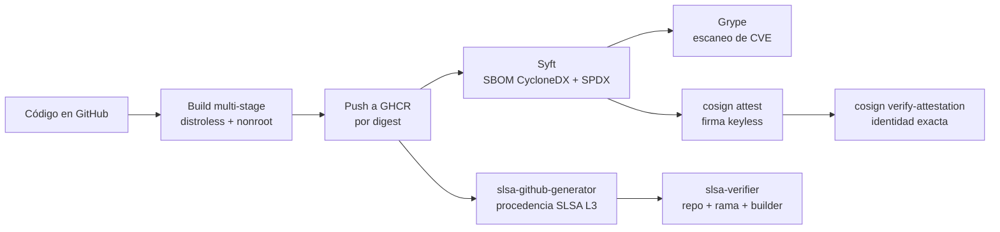

# Laboratorio 246 — Supply chain security: SBOM y SLSA

Diplomado Cloud Forge · Educación Continua Unicomfacauca

Laboratorio de seguridad de la cadena de suministro de software sobre Windows 10/11 y GitHub Actions. Se genera el **SBOM** de una aplicación Go y de su imagen Docker, se consume con **Grype** para detectar vulnerabilidades, se adjunta como **atestación firmada con cosign** y se genera **procedencia SLSA** verificable que vincula la imagen con su código fuente y su build.

> El SBOM describe **qué contiene** un artefacto. SLSA establece garantías sobre **cómo fue construido**.

[](https://github.com/bermudezkenny03/laboratorio-sbom-slsa/actions/workflows/sbom-slsa.yml)

---

## Flujo del pipeline



## Estructura

```
laboratorio-sbom-slsa/
├── app/
│   └── main.go                       # API HTTP mínima en :8080 (/ y /health)
├── scripts/
│   ├── _comun.ps1                    # funciones compartidas (logs UTF-8, validaciones)
│   ├── 00-verificar-entorno.ps1      # verifica herramientas y guarda versiones
│   ├── 01-generar-sbom.ps1           # SBOM del código
│   ├── 02-escanear-sbom.ps1          # Grype sobre el SBOM de la imagen
│   ├── 03-construir-imagen.ps1       # docker build
│   ├── 04-sbom-imagen.ps1            # SBOM de la imagen
│   ├── 05-adjuntar-atestacion.ps1    # cosign attest (keyless)
│   ├── 06-verificar-atestacion.ps1   # cosign verify-attestation
│   ├── 07-verificar-procedencia.ps1  # slsa-verifier (opcional en local)
│   └── pipeline-local.ps1            # ejecuta todo en orden
├── .github/workflows/sbom-slsa.yml   # CI: build, SBOM, Grype, cosign y SLSA L3
├── evidencias/                       # capturas de pantalla para la entrega
├── reports/                          # salidas generadas por los scripts
├── Dockerfile
├── .dockerignore
└── go.mod
```

## 1. Requisitos e instalación (Windows)

- Windows 10/11 con permisos de administrador
- Docker Desktop con WSL 2 (abierto y con "Engine running")
- Git for Windows
- PowerShell 7 o Windows PowerShell 5.1

```powershell
winget install Docker.DockerDesktop
winget install Git.Git
winget install Anchore.Syft
winget install Anchore.Grype
winget install Sigstore.Cosign
```

Cierra y vuelve a abrir la terminal para que el PATH se actualice. Luego:

```powershell
git clone https://github.com/bermudezkenny03/laboratorio-sbom-slsa.git
cd laboratorio-sbom-slsa
powershell -ExecutionPolicy Bypass -File .\scripts\00-verificar-entorno.ps1
```

📸 **Evidencia 1:** salida del script 00 con todas las herramientas en verde (`reports/versiones-herramientas.txt`).

## 2. Ejecución local paso a paso

El orden de ejecución no coincide con la numeración de los archivos (que respeta la guía): primero se construye la imagen y después se escanea su SBOM.

| Orden | Script | Qué hace | Salida |
|---|---|---|---|
| 1 | `01-generar-sbom.ps1` | SBOM del código fuente | `reports/sbom-codigo.cdx.json`, `reports/sbom-codigo.spdx.json` |
| 2 | `03-construir-imagen.ps1` | Construye `lab246:1.0.0` | `reports/imagen-info.txt` |
| 3 | `04-sbom-imagen.ps1` | SBOM de la imagen final | `reports/sbom-imagen.cdx.json`, `reports/sbom-imagen.spdx.json` |
| 4 | `02-escanear-sbom.ps1` | Vulnerabilidades con Grype | `reports/grype-resultados.json`, `.txt` |

```powershell
powershell -ExecutionPolicy Bypass -File .\scripts\01-generar-sbom.ps1
powershell -ExecutionPolicy Bypass -File .\scripts\03-construir-imagen.ps1
powershell -ExecutionPolicy Bypass -File .\scripts\04-sbom-imagen.ps1
powershell -ExecutionPolicy Bypass -File .\scripts\02-escanear-sbom.ps1
```

O todo de una vez:

```powershell
powershell -ExecutionPolicy Bypass -File .\scripts\pipeline-local.ps1
```

📸 **Evidencia 2:** resumen del SBOM del código y de la imagen (compara cuántos componentes tiene cada uno).
📸 **Evidencia 3:** propiedades de la imagen (usuario `nonroot`, tamaño).
📸 **Evidencia 4:** resumen de Grype por severidad y componentes afectados.

> **Qué observar:** el SBOM del código solo ve `go.mod` y las GitHub Actions del workflow. El SBOM de la imagen además incluye los paquetes Debian de la base distroless y la versión exacta de la biblioteca estándar de Go compilada dentro del binario. Por eso la evidencia principal es el SBOM del artefacto final.

### 2.1 Publicar la imagen en GHCR

Crea un token en <https://github.com/settings/tokens> (classic) con el permiso `write:packages` y úsalo como contraseña:

```powershell
docker login ghcr.io -u bermudezkenny03
docker tag lab246:1.0.0 ghcr.io/bermudezkenny03/laboratorio-sbom-slsa:1.0.0-local
docker push ghcr.io/bermudezkenny03/laboratorio-sbom-slsa:1.0.0-local
docker inspect --format "{{index .RepoDigests 0}}" ghcr.io/bermudezkenny03/laboratorio-sbom-slsa:1.0.0-local
```

Copia el resultado `ghcr.io/bermudezkenny03/laboratorio-sbom-slsa@sha256:...`. Siempre se firma y verifica **por digest**, nunca por tag, porque un tag puede moverse a otra imagen.

### 2.2 Adjuntar el SBOM como atestación firmada

```powershell
powershell -ExecutionPolicy Bypass -File .\scripts\05-adjuntar-atestacion.ps1 `
  -ImageDigest "ghcr.io/bermudezkenny03/laboratorio-sbom-slsa@sha256:TU_DIGEST"
```

cosign abre el navegador: elige **GitHub** e inicia sesión. Sigstore emite un certificado de 10 minutos con tu identidad, firma la atestación y la registra en el log público Rekor (la salida muestra el `tlog entry` con su índice).

📸 **Evidencia 5:** salida de `cosign attest` (`reports/cosign-attest.txt`).

### 2.3 Verificar la atestación

```powershell
# Modo estricto: exige que la haya firmado tu cuenta
powershell -ExecutionPolicy Bypass -File .\scripts\06-verificar-atestacion.ps1 `
  -ImageDigest "ghcr.io/bermudezkenny03/laboratorio-sbom-slsa@sha256:TU_DIGEST" `
  -Identidad "el-correo-de-tu-cuenta-github@ejemplo.com"
```

Sin `-Identidad` el script usa `--certificate-identity-regexp '.*'` como en la guía y muestra una advertencia: eso solo comprueba que *alguien* firmó, no *quién*. En producción siempre se fija la identidad y el emisor OIDC.

📸 **Evidencia 6:** salida de `cosign verify-attestation` con el tipo de predicado, el sujeto (digest) y el número de componentes (`reports/cosign-verify-local.txt`).

## 3. Pipeline en GitHub Actions

El workflow [`.github/workflows/sbom-slsa.yml`](.github/workflows/sbom-slsa.yml) se ejecuta con cada push a `main` y manualmente desde **Actions → sbom-slsa → Run workflow**.

| Job | Qué hace |
|---|---|
| `build` | Construye y publica la imagen en GHCR, genera SBOM del código y de la imagen (CycloneDX y SPDX) sobre el digest publicado, escanea con Grype, firma el SBOM con `cosign attest` (keyless con el OIDC de GitHub) y lo verifica exigiendo la identidad exacta del workflow |
| `procedencia` | Genera procedencia SLSA firmada con el builder oficial [`slsa-github-generator`](https://github.com/slsa-framework/slsa-github-generator) (Build L3) y la sube a GHCR junto a la imagen |
| `verificar-procedencia` | Verifica la procedencia con `slsa-verifier`: builder confiable, repositorio y rama de origen |
| `evidencias` | Solo en ejecución manual: guarda en el repo las salidas reales de la ejecución (`reports/ci/`), un informe y capturas (`evidencias/`) |

Controles de endurecimiento aplicados:

- `permissions: {}` global y permisos mínimos por job
- Actions de terceros fijadas por SHA de commit (el generador SLSA y el instalador de slsa-verifier se referencian por tag porque así lo exigen)
- `persist-credentials: false` en el checkout de build (solo el job `evidencias` conserva credenciales para hacer commit)
- Variables de contexto pasadas por `env`, no interpoladas en scripts (evita inyección)
- Runners efímeros alojados por GitHub
- SBOM generado en el mismo job que produce el artefacto y sobre su digest

**Artefactos que publica cada ejecución** (pestaña *Summary* de la ejecución, al final):

| Artefacto | Contenido |
|---|---|
| `sbom-cyclonedx` | `sbom-codigo.cdx.json`, `sbom-imagen.cdx.json` |
| `sbom-spdx` | `sbom-codigo.spdx.json`, `sbom-imagen.spdx.json` |
| `escaneo-y-atestacion` | resultados de Grype, salida de `cosign attest` y `cosign verify-attestation` |
| `procedencia-slsa` | procedencia verificada y salida de `slsa-verifier` |

📄 **Evidencias del CI:** [`evidencias/EVIDENCIAS-CI.md`](evidencias/EVIDENCIAS-CI.md) reúne el informe y las capturas de la última ejecución manual, generados a partir de sus salidas reales.
📸 **Evidencia 7:** pestaña Actions con los jobs en verde y el *Summary* de la ejecución.

### 3.1 Verificar desde tu PC lo que firmó el CI

Toma el digest del *Summary* del job `build`:

```powershell
# Atestación SBOM firmada por el workflow
powershell -ExecutionPolicy Bypass -File .\scripts\06-verificar-atestacion.ps1 `
  -ImageDigest "ghcr.io/bermudezkenny03/laboratorio-sbom-slsa@sha256:DIGEST_DEL_CI" `
  -Repo "bermudezkenny03/laboratorio-sbom-slsa"

# Procedencia SLSA (requiere slsa-verifier, ver cabecera del script)
powershell -ExecutionPolicy Bypass -File .\scripts\07-verificar-procedencia.ps1 `
  -ImageDigest "ghcr.io/bermudezkenny03/laboratorio-sbom-slsa@sha256:DIGEST_DEL_CI" `
  -Repo "bermudezkenny03/laboratorio-sbom-slsa"
```

Si el paquete en GHCR es privado, haz `docker login ghcr.io` antes, o hazlo público en *Packages → laboratorio-sbom-slsa → Package settings → Change visibility*.

## 4. Remediación de vulnerabilidades

La guía compila con Go 1.22, que ya no recibe parches de seguridad, así que Grype reportará CVE en el componente `stdlib`. Para demostrar el ciclo completo **detectar → corregir → verificar**:

```powershell
powershell -ExecutionPolicy Bypass -File .\scripts\03-construir-imagen.ps1 -GoVersion 1.27 -Tag 1.0.1
powershell -ExecutionPolicy Bypass -File .\scripts\04-sbom-imagen.ps1 -Imagen lab246:1.0.1
powershell -ExecutionPolicy Bypass -File .\scripts\02-escanear-sbom.ps1
```

En CI: **Run workflow** con `go_version = 1.27`. El job `evidencias` guarda esa ejecución en `evidencias/remediacion-go1.27/` con una tabla de antes y después frente a la línea base de Go 1.22.

📸 **Evidencia 11 (opcional):** comparación de vulnerabilidades con Go 1.22 y con Go 1.27.

## 5. Entregables

| Entregable | Archivo o evidencia |
|---|---|
| SBOM CycloneDX del código | `reports/sbom-codigo.cdx.json` · artefacto `sbom-cyclonedx` |
| SBOM SPDX del código | `reports/sbom-codigo.spdx.json` · artefacto `sbom-spdx` |
| SBOM CycloneDX de la imagen | `reports/sbom-imagen.cdx.json` · artefacto `sbom-cyclonedx` |
| SBOM SPDX de la imagen | `reports/sbom-imagen.spdx.json` · artefacto `sbom-spdx` |
| Escaneo de vulnerabilidades | `reports/grype-resultados.json` · artefacto `escaneo-y-atestacion` |
| Atestación firmada | `reports/cosign-attest.txt` · paso de CI "Adjuntar el SBOM…" |
| Verificación de atestación | `reports/cosign-verify-*.txt` · paso de CI "Verificar la atestación…" |
| Procedencia SLSA verificable | artefacto `procedencia-slsa` · job `verificar-procedencia` |
| Pipeline CI/CD | `.github/workflows/sbom-slsa.yml` |

## 6. Autoevaluación SLSA Build

| Nivel | Requisito | Evidencia en este repositorio | Estado |
|---|---|---|---|
| Build L1 | Existe procedencia que describe cómo se construyó el artefacto | `procedencia-slsa.json` generado para cada imagen publicada | Cumple |
| Build L2 | Build en plataforma alojada que genera y firma la procedencia | GitHub Actions + firma Sigstore de la procedencia, verificada con `slsa-verifier` | Cumple |
| Build L3 | Plataforma endurecida: la procedencia no puede ser falsificada por el propio build | `slsa-github-generator` firma en un workflow reutilizable aislado del job de build; runners efímeros; permisos mínimos | Cumple |

**Nivel alcanzado: SLSA Build L3** para las imágenes que publica el workflow. Las imágenes construidas en el PC local (paso 2) no tienen procedencia de una plataforma confiable, así que no alcanzan ningún nivel: por eso la imagen que se distribuye es la del CI.

La atestación del SBOM con cosign **no es** procedencia SLSA: prueba quién firmó la lista de componentes, pero no cómo se construyó la imagen. Son controles complementarios.

## 7. Ajustes respecto a la guía original

| Guía | Problema | Ajuste |
|---|---|---|
| `go build ... .` en la raíz | `main.go` está en `app/`; el build falla con "no Go files" | Se compila `./app` |
| `syft ... > archivo.json` | En Windows PowerShell 5.1 `>` escribe UTF-16 y Grype/cosign no pueden leer el JSON | Se usa `-o formato=archivo` de Syft/Grype |
| `trivy image ...` | Trivy no está en los requisitos | Se usa Grype como escáner principal |
| `cosign attest` / `verify-attestation` | cosign v3 usa por defecto la API OCI *referrers*, que GHCR no implementa | Se usa el formato clásico (`--new-bundle-format=false`); cosign muestra un aviso de *deprecated*, es esperado |
| `--certificate-identity-regexp '.*'` | Acepta cualquier firmante | Verificación con identidad exacta (local y CI); el modo abierto queda solo para practicar |
| SLSA L2 "con el generador" | El workflow original solo llegaba a L1 | Se integra `slsa-github-generator` (L3) y `slsa-verifier` |

## 8. Errores comunes

| Problema | Causa probable | Solución |
|---|---|---|
| `no se reconoce syft / grype / cosign` | La terminal se abrió antes de instalar | Cierra y abre una terminal nueva |
| `Docker no responde` | Docker Desktop cerrado | Abre Docker Desktop y espera "Engine running" |
| `denied: permission_denied` al hacer push | Token sin `write:packages` o usuario en mayúsculas | Nuevo token y nombre de imagen en minúsculas |
| Grype no descarga la base de datos | Sin internet o proxy | Reintenta con conexión; la base se descarga una vez |
| `verify-attestation`: *no matching attestations* | Identidad, emisor o `--type` distintos a los de la firma | Revisa `-Identidad` (tu correo de GitHub) o usa `-Repo` para la firma del CI |
| `cosign attest` no abre el navegador | Navegador bloqueado | Copia la URL que muestra cosign y ábrela manualmente |
| El job `procedencia` falla al iniciar | El generador se referenció por SHA | Debe usarse por tag `@v2.1.0` |
| SBOM sin dependencias transitivas | Generado desde manifiestos | Generarlo desde la imagen (paso 3) |
