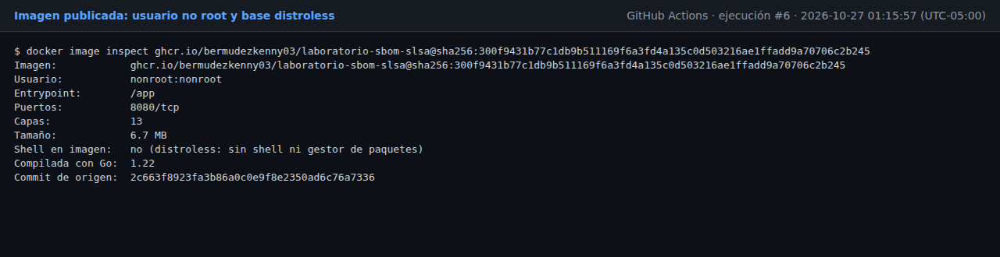
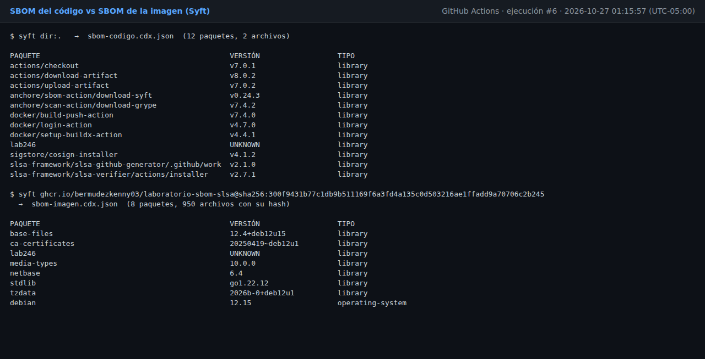
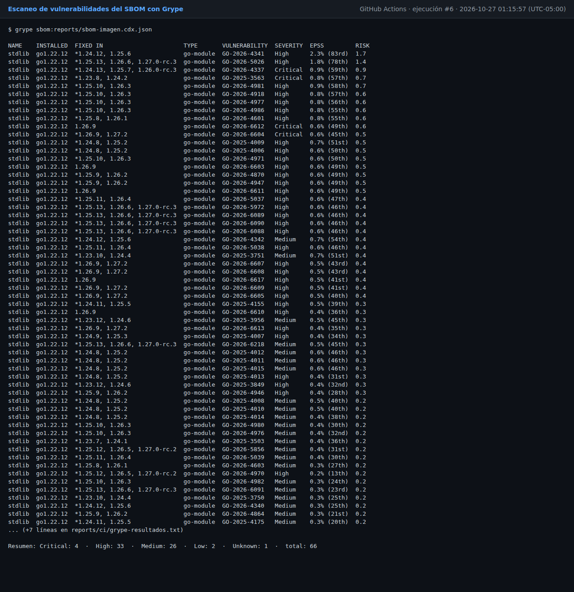
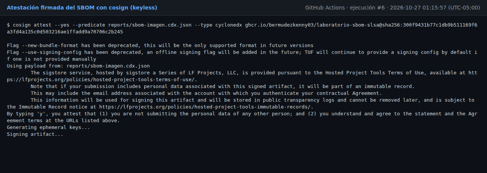
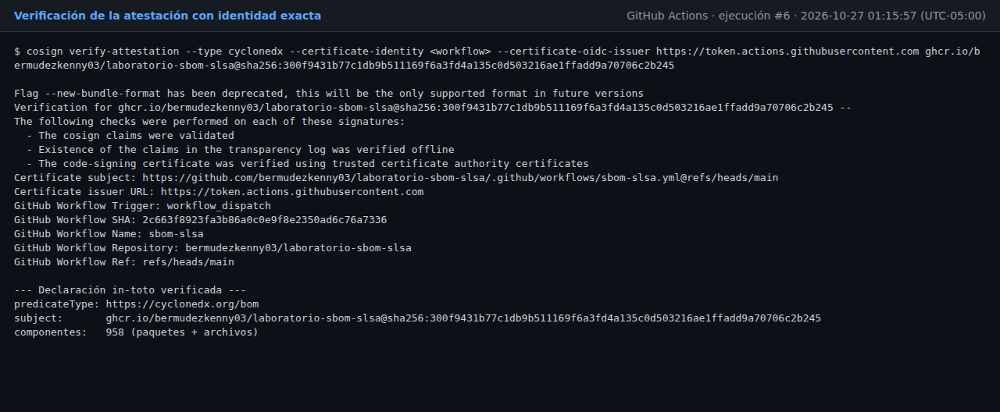
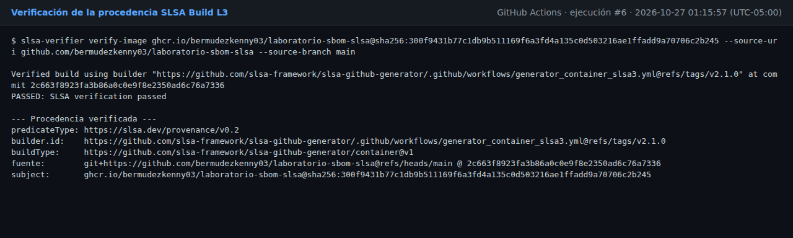

# Evidencias del pipeline en GitHub Actions

Generadas automáticamente a partir de las salidas reales de la ejecución
[#6](https://github.com/bermudezkenny03/laboratorio-sbom-slsa/actions/runs/40459596072) del workflow `sbom-slsa` (2026-10-27 01:15:57 (UTC-05:00)).
Los archivos completos están en [`reports/ci/`](https://github.com/bermudezkenny03/laboratorio-sbom-slsa/tree/main/reports/ci).


| Dato | Valor |
|---|---|
| Ejecución | https://github.com/bermudezkenny03/laboratorio-sbom-slsa/actions/runs/40459596072 |
| Commit | `2c663f8923fa3b86a0c0e9f8e2350ad6c76a7336` |
| Imagen | `ghcr.io/bermudezkenny03/laboratorio-sbom-slsa@sha256:300f9431b77c1db9b511169f6a3fd4a135c0d503216ae1ffadd9a70706c2b245` |
| Go | `1.22` |

## 1. Imagen endurecida

Usuario `nonroot:nonroot`, base distroless (shell en la imagen: no (distroless: sin shell ni gestor de paquetes)), tamaño 6.7 MB, 13 capas.



## 2. SBOM del código vs SBOM de la imagen

| Origen | Paquetes | Archivos inventariados | SBOM |
|---|---|---|---|
| Código | 12 | 2 | `sbom-codigo.cdx.json`, `sbom-codigo.spdx.json` |
| Imagen | 8 | 950 | `sbom-imagen.cdx.json`, `sbom-imagen.spdx.json` |

El SBOM del código solo ve `go.mod` y las GitHub Actions del workflow. El de la imagen incluye el sistema
operativo base, sus paquetes Debian, la biblioteca estándar de Go compilada en el binario y cada archivo de la
imagen con su hash: es la evidencia principal.

```
PAQUETE                                            VERSIÓN                  TIPO
base-files                                         12.4+deb12u15            library
ca-certificates                                    20250419~deb12u1         library
lab246                                             UNKNOWN                  library
media-types                                        10.0.0                   library
netbase                                            6.4                      library
stdlib                                             go1.22.12                library
tzdata                                             2026b-0+deb12u1          library
debian                                             12.15                    operating-system
```



## 3. Vulnerabilidades (Grype sobre el SBOM de la imagen)

| Severidad | Cantidad |
|---|---|
| Critical | 4 |
| High | 33 |
| Medium | 26 |
| Low | 2 |
| Unknown | 1 |
| **Total** | **66** |

| CVE | Componente | Severidad | Versión corregida |
|---|---|---|---|
| GO-2026-4337 | stdlib go1.22.12 | Critical | 1.24.13, 1.25.7, 1.26.0-rc.3 |
| GO-2025-3563 | stdlib go1.22.12 | Critical | 1.23.8, 1.24.2 |
| GO-2026-6612 | stdlib go1.22.12 | Critical | 1.26.9 |
| GO-2026-6604 | stdlib go1.22.12 | Critical | 1.26.9, 1.27.2 |
| GO-2026-4341 | stdlib go1.22.12 | High | 1.24.12, 1.25.6 |
| GO-2026-5026 | stdlib go1.22.12 | High | 1.25.13, 1.26.6, 1.27.0-rc.3 |
| GO-2026-4981 | stdlib go1.22.12 | High | 1.25.10, 1.26.3 |
| GO-2026-4918 | stdlib go1.22.12 | High | 1.25.10, 1.26.3 |
| GO-2026-4977 | stdlib go1.22.12 | High | 1.25.10, 1.26.3 |
| GO-2026-4986 | stdlib go1.22.12 | High | 1.25.10, 1.26.3 |
| GO-2026-4601 | stdlib go1.22.12 | High | 1.25.8, 1.26.1 |
| GO-2025-4009 | stdlib go1.22.12 | High | 1.24.8, 1.25.2 |
| GO-2025-4006 | stdlib go1.22.12 | High | 1.24.8, 1.25.2 |
| GO-2026-4971 | stdlib go1.22.12 | High | 1.25.10, 1.26.3 |
| GO-2026-6603 | stdlib go1.22.12 | High | 1.26.9 |
| GO-2026-4870 | stdlib go1.22.12 | High | 1.25.9, 1.26.2 |
| GO-2026-4947 | stdlib go1.22.12 | High | 1.25.9, 1.26.2 |
| GO-2026-6611 | stdlib go1.22.12 | High | 1.26.9 |
| GO-2026-5037 | stdlib go1.22.12 | High | 1.25.11, 1.26.4 |
| GO-2026-5972 | stdlib go1.22.12 | High | 1.25.13, 1.26.6, 1.27.0-rc.3 |
| GO-2026-6089 | stdlib go1.22.12 | High | 1.25.13, 1.26.6, 1.27.0-rc.3 |
| GO-2026-6090 | stdlib go1.22.12 | High | 1.25.13, 1.26.6, 1.27.0-rc.3 |
| GO-2026-6088 | stdlib go1.22.12 | High | 1.25.13, 1.26.6, 1.27.0-rc.3 |
| GO-2026-5038 | stdlib go1.22.12 | High | 1.25.11, 1.26.4 |
| GO-2026-6607 | stdlib go1.22.12 | High | 1.26.9, 1.27.2 |
| GO-2026-6608 | stdlib go1.22.12 | High | 1.26.9, 1.27.2 |
| GO-2026-6617 | stdlib go1.22.12 | High | 1.26.9 |
| GO-2026-6609 | stdlib go1.22.12 | High | 1.26.9, 1.27.2 |
| GO-2026-6605 | stdlib go1.22.12 | High | 1.26.9, 1.27.2 |
| GO-2025-4155 | stdlib go1.22.12 | High | 1.24.11, 1.25.5 |
| GO-2026-6610 | stdlib go1.22.12 | High | 1.26.9 |
| GO-2026-6613 | stdlib go1.22.12 | High | 1.26.9, 1.27.2 |
| GO-2025-4007 | stdlib go1.22.12 | High | 1.24.9, 1.25.3 |
| GO-2025-4013 | stdlib go1.22.12 | High | 1.24.8, 1.25.2 |
| GO-2025-3849 | stdlib go1.22.12 | High | 1.23.12, 1.24.6 |
| GO-2026-4946 | stdlib go1.22.12 | High | 1.25.9, 1.26.2 |
| GO-2026-4970 | stdlib go1.22.12 | High | 1.25.12, 1.26.5, 1.27.0-rc.2 |
| GO-2026-4342 | stdlib go1.22.12 | Medium | 1.24.12, 1.25.6 |
| GO-2025-3751 | stdlib go1.22.12 | Medium | 1.23.10, 1.24.4 |
| GO-2025-3956 | stdlib go1.22.12 | Medium | 1.23.12, 1.24.6 |



## 4. Atestación firmada del SBOM (cosign)

- Tipo de predicado: `https://cyclonedx.org/bom`
- Sujeto: `ghcr.io/bermudezkenny03/laboratorio-sbom-slsa@sha256:300f9431b77c1db9b511169f6a3fd4a135c0d503216ae1ffadd9a70706c2b245`
- Componentes en el SBOM firmado: 958 (paquetes + archivos)
- Entrada en el log de transparencia Rekor: 
- Firmante verificado: el workflow `.github/workflows/sbom-slsa.yml` de este repositorio (emisor `https://token.actions.githubusercontent.com`)





## 5. Procedencia SLSA verificada

- Tipo de predicado: `https://slsa.dev/provenance/v0.2`
- Builder: `https://github.com/slsa-framework/slsa-github-generator/.github/workflows/generator_container_slsa3.yml@refs/tags/v2.1.0`
- Fuente: `git+https://github.com/bermudezkenny03/laboratorio-sbom-slsa@refs/heads/main @ 2c663f8923fa3b86a0c0e9f8e2350ad6c76a7336`
- Sujeto: `ghcr.io/bermudezkenny03/laboratorio-sbom-slsa@sha256:300f9431b77c1db9b511169f6a3fd4a135c0d503216ae1ffadd9a70706c2b245`



## 6. Nivel SLSA alcanzado

| Nivel | Requisito | Evidencia | Estado |
|---|---|---|---|
| Build L1 | Existe procedencia | `reports/ci/procedencia-slsa.json` | Cumple |
| Build L2 | Plataforma alojada y procedencia firmada | GitHub Actions + firma Sigstore verificada por `slsa-verifier` | Cumple |
| Build L3 | Builder endurecido y aislado | `slsa-github-generator` en workflow reutilizable aislado, runners efímeros | Cumple |
