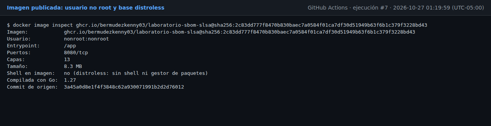
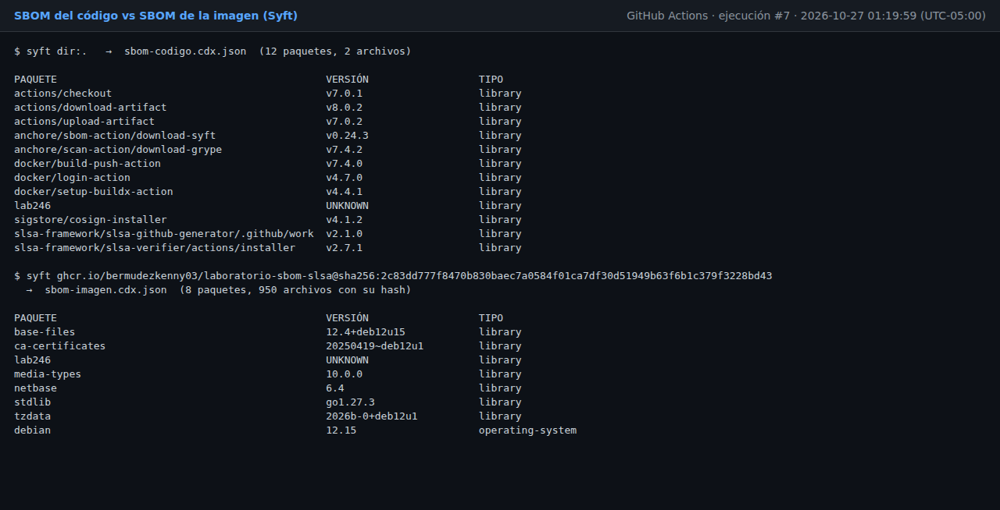
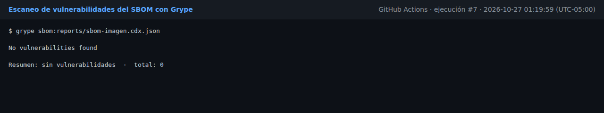
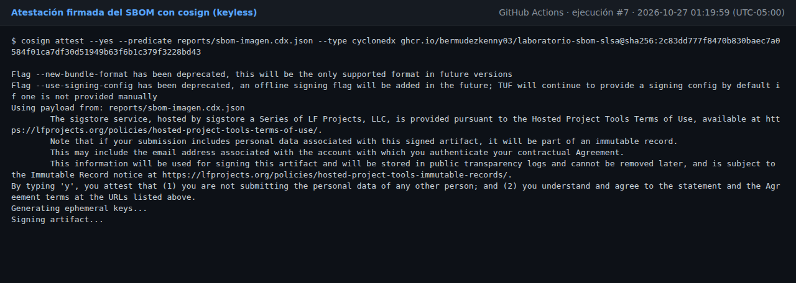
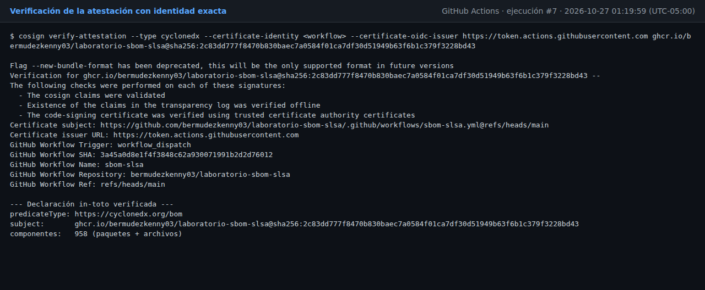
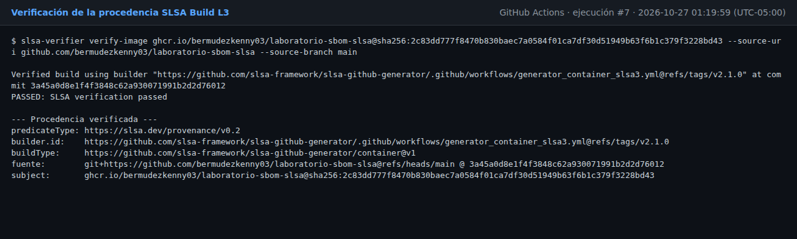

# Evidencias del pipeline en GitHub Actions

Generadas automáticamente a partir de las salidas reales de la ejecución
[#7](https://github.com/bermudezkenny03/laboratorio-sbom-slsa/actions/runs/40460120774) del workflow `sbom-slsa` (2026-10-27 01:19:59 (UTC-05:00)).
Los archivos completos están en [`reports/ci-go1.27/`](https://github.com/bermudezkenny03/laboratorio-sbom-slsa/tree/main/reports/ci-go1.27).

## Remediación: antes y después

| | Antes (línea base) | Después (esta ejecución) |
|---|---|---|
| Biblioteca estándar de Go | `go1.22.12` | `go1.27.3` |
| Critical | 4 | 0 |
| High | 33 | 0 |
| **Total de vulnerabilidades** | **66** | **0** |

Línea base: [`reports/ci/`](https://github.com/bermudezkenny03/laboratorio-sbom-slsa/tree/main/reports/ci) · Esta ejecución: [`reports/ci-go1.27/`](https://github.com/bermudezkenny03/laboratorio-sbom-slsa/tree/main/reports/ci-go1.27)

| Dato | Valor |
|---|---|
| Ejecución | https://github.com/bermudezkenny03/laboratorio-sbom-slsa/actions/runs/40460120774 |
| Commit | `3a45a0d8e1f4f3848c62a930071991b2d2d76012` |
| Imagen | `ghcr.io/bermudezkenny03/laboratorio-sbom-slsa@sha256:2c83dd777f8470b830baec7a0584f01ca7df30d51949b63f6b1c379f3228bd43` |
| Go | `1.27` |

## 1. Imagen endurecida

Usuario `nonroot:nonroot`, base distroless (shell en la imagen: no (distroless: sin shell ni gestor de paquetes)), tamaño 8.3 MB, 13 capas.



## 2. SBOM del código vs SBOM de la imagen

| Origen | Paquetes | Archivos inventariados | SBOM |
|---|---|---|---|
| Código | 12 | 2 | `sbom-codigo.cdx.json`, `sbom-codigo.spdx.json` |
| Imagen | 8 | 950 | `sbom-imagen.cdx.json`, `sbom-imagen.spdx.json` |

El SBOM del código solo ve `go.mod` y las GitHub Actions del workflow. El de la imagen incluye el sistema
operativo base, sus paquetes Debian, la biblioteca estándar de Go compilada en el binario y cada archivo de la
imagen con su hash: es la evidencia principal.

```
PAQUETE                                            VERSIÓN                  TIPO
base-files                                         12.4+deb12u15            library
ca-certificates                                    20250419~deb12u1         library
lab246                                             UNKNOWN                  library
media-types                                        10.0.0                   library
netbase                                            6.4                      library
stdlib                                             go1.27.3                 library
tzdata                                             2026b-0+deb12u1          library
debian                                             12.15                    operating-system
```



## 3. Vulnerabilidades (Grype sobre el SBOM de la imagen)

| Severidad | Cantidad |
|---|---|
| (ninguna) | 0 |
| **Total** | **0** |




## 4. Atestación firmada del SBOM (cosign)

- Tipo de predicado: `https://cyclonedx.org/bom`
- Sujeto: `ghcr.io/bermudezkenny03/laboratorio-sbom-slsa@sha256:2c83dd777f8470b830baec7a0584f01ca7df30d51949b63f6b1c379f3228bd43`
- Componentes en el SBOM firmado: 958 (paquetes + archivos)
- Entrada en el log de transparencia Rekor: 
- Firmante verificado: el workflow `.github/workflows/sbom-slsa.yml` de este repositorio (emisor `https://token.actions.githubusercontent.com`)





## 5. Procedencia SLSA verificada

- Tipo de predicado: `https://slsa.dev/provenance/v0.2`
- Builder: `https://github.com/slsa-framework/slsa-github-generator/.github/workflows/generator_container_slsa3.yml@refs/tags/v2.1.0`
- Fuente: `git+https://github.com/bermudezkenny03/laboratorio-sbom-slsa@refs/heads/main @ 3a45a0d8e1f4f3848c62a930071991b2d2d76012`
- Sujeto: `ghcr.io/bermudezkenny03/laboratorio-sbom-slsa@sha256:2c83dd777f8470b830baec7a0584f01ca7df30d51949b63f6b1c379f3228bd43`



## 6. Nivel SLSA alcanzado

| Nivel | Requisito | Evidencia | Estado |
|---|---|---|---|
| Build L1 | Existe procedencia | `reports/ci-go1.27/procedencia-slsa.json` | Cumple |
| Build L2 | Plataforma alojada y procedencia firmada | GitHub Actions + firma Sigstore verificada por `slsa-verifier` | Cumple |
| Build L3 | Builder endurecido y aislado | `slsa-github-generator` en workflow reutilizable aislado, runners efímeros | Cumple |
